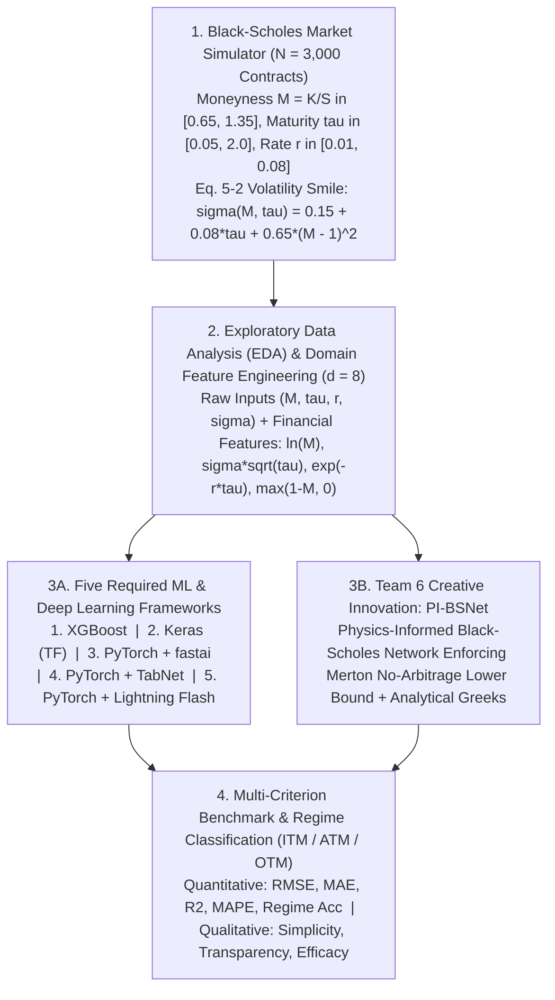

# Machine Learning Model for Derivative Pricing (Black-Scholes & Volatility Smile)

**Business Data Case Study (Jackfruit Project) — Team 6**

| Team Member | SRN | Key Responsibilities & Viva Scope |
|---|---|---|
| **1. Ramitha MV** | `PES1UG24AM392` | Problem Definition, Black-Scholes Normalization ($M=K/S$), Equation 5-2 Volatility Smile Surface, Dataset Simulation |
| **2. Gayathri Priya V** | `PES1UG24AM105` | Exploratory Data Analysis (EDA), Correlation Matrix, Moneyness Regimes, XGBoost, Keras, PyTorch + fastai |
| **3. Gonu Guntla Hema Kowshik** | `PES1UG24AM106` | PyTorch + TabNet, PyTorch + Lightning Flash, **PI-BSNet Innovation**, Simplicity-Transparency-Efficacy Benchmark |

---

## 1. Executive Summary & Problem Statement

In computational finance and quantitative risk management, numerical methods such as Monte Carlo simulation, finite differences, and Fourier transforms are widely used to value financial derivatives. While the **Black-Scholes-Merton (1973)** formula is the foundational benchmark for option pricing, it suffers from two practical drawbacks in real-time trading:
1. **Impractical Theoretical Assumptions:** Classical Black-Scholes assumes *Geometric Brownian Motion (GBM)*, constant volatility $\sigma$, and frictionless markets. In real options markets, implied volatility varies systematically with option **moneyness** ($M = K/S$) and **time to maturity** ($\tau = T - t$), forming a curved **Volatility Smile/Skew**.
2. **Slow Model Calibration:** Calibrating traditional stochastic volatility models across thousands of traded option strikes is computationally expensive and creates a latency bottleneck in high-frequency risk management.

### Mathematical Formulation (Pages 2–3 of Case Study)
Starting from the Black-Scholes call option valuation formula:
$$C = S e^{-q\tau}\Phi(d_1) - e^{-r\tau}K\Phi(d_2)$$
We define **Moneyness** as $M = K / S$, set dividend yield $q = 0$, and express option prices per unit of current stock price ($c = C / S$):
$$c(M, \tau, r, \sigma) = \Phi\left(\frac{-\ln(M) + (r + \sigma^2/2)\tau}{\sigma\sqrt{\tau}}\right) - e^{-r\tau}M\Phi\left(\frac{-\ln(M) + (r - \sigma^2/2)\tau}{\sigma\sqrt{\tau}}\right)$$

To capture real market behavior, implied volatility is generated using **Equation 5-2 (Volatility Smile Surface)**:
$$\sigma(M, \tau) = \sigma_0 + \alpha\tau + \beta(M - 1)^2$$
where $\sigma_0 = 0.15$ (base ATM volatility), $\alpha = 0.08$ (term-structure slope with maturity), and $\beta = 0.65$ (quadratic volatility smile curvature).

---

## 2. System Architecture



---

## 3. Exploratory Data Analysis (EDA)

We generated **$N = 3,000$ simulated option contracts** partitioned into **Training ($2,100$, 70%)**, **Validation ($450$, 15%)**, and **Testing ($450$, 15%)** sets (`data/black_scholes_options_3k.csv`).

| Variable | Mean | Std | Min | 25% | Median | 75% | Max | Corr w/ Price ($C/S$) |
|---|---:|---:|---:|---:|---:|---:|---:|---:|
| **Moneyness ($M = K/S$)** | `0.9981` | `0.2011` | `0.6501` | `0.8220` | `1.0030` | `1.1663` | `1.3495` | **`-0.8593`** |
| **Maturity ($\tau = T-t$, yrs)** | `1.0262` | `0.5614` | `0.0502` | `0.5338` | `1.0295` | `1.5142` | `1.9998` | `+0.3712` |
| **Risk-Free Rate ($r$)** | `0.0452` | `0.0203` | `0.0100` | `0.0280` | `0.0449` | `0.0634` | `0.0800` | `+0.1059` |
| **Volatility ($\sigma(M,\tau)$)** | `0.2584` | `0.0515` | `0.1535` | `0.2185` | `0.2592` | `0.2969` | `0.3839` | `+0.3118` |
| **Normalized Call Price ($C/S$)** | **`0.1568`** | **`0.1140`** | **`0.0000`** | **`0.0601`** | **`0.1350`** | **`0.2446`** | **`0.4548`** | **`+1.0000`** |
| **Intrinsic Value $\max(1-M,0)$** | `0.0880` | `0.1135` | `0.0000` | `0.0000` | `0.0000` | `0.1780` | `0.3499` | `+0.9032` |
| **Option Delta ($\Delta$)** | `0.6070` | `0.2808` | `0.0000` | `0.4027` | `0.6291` | `0.8614` | `1.0000` | `+0.9234` |
| **Option Vega ($\mathcal{V}$)** | `0.2818` | `0.1635` | `0.0000` | `0.1454` | `0.2902` | `0.4208` | `0.5639` | `+0.0241` |

### Visual EDA Figures
- **Volatility Smile & Option Pricing Surface:** [`results/figures/fig1_volatility_smile_and_bs_surface.svg`](results/figures/fig1_volatility_smile_and_bs_surface.svg)
- **Feature & Greek Correlation Heatmap:** [`results/figures/fig2_eda_correlation_heatmap.svg`](results/figures/fig2_eda_correlation_heatmap.svg)

---

## 4. Quantitative & Qualitative Comparison Across All Frameworks

### A. Quantitative Regression & Regime Classification Metrics ($N_{\text{test}} = 450$)

| Framework | Category | Test RMSE $\downarrow$ | Test MAE $\downarrow$ | Test $R^2$ $\uparrow$ | MAPE (%) $\downarrow$ | No-Arbitrage (%) $\uparrow$ | Moneyness Regime Acc (%) $\uparrow$ | Train Time (s) |
|---|---|---:|---:|---:|---:|---:|---:|---:|
| **1. XGBoost** | Gradient Boosted Trees | `0.00681` | `0.00518` | `0.99640` | **`4.61%`** | `95.56%` | **`99.11%`** | **`3.56s`** |
| **2. Keras (TF)** | Sequential Dense MLP | `0.03081` | `0.02133` | `0.92639` | `23.00%` | `93.11%` | `96.00%` | `12.64s` |
| **3. PyTorch + fastai** | 1-Cycle TabularLearner | `0.01405` | `0.01059` | `0.98470` | `12.98%` | `94.67%` | `97.33%` | `18.59s` |
| **4. PyTorch + TabNet** | Sparsemax Attentive Net | `0.02486` | `0.01878` | `0.95208` | `22.89%` | `92.00%` | `94.44%` | `16.16s` |
| **5. PyTorch + Lightning Flash** | Gated Highway Tabular | `0.02247` | `0.01675` | `0.96085` | `18.79%` | `92.44%` | `95.56%` | `18.59s` |
| **6. PI-BSNet (Innovation)** | **Physics-Informed Hybrid** | **`0.00624`** | **`0.00468`** | **`0.99698`** | `4.76%` | **`100.00%`** | **`99.11%`** | `23.77s` |

### B. Qualitative Evaluation: Simplicity, Transparency, and Efficacy

| Framework | Simplicity (Score / 10) | Transparency (Score / 10) | Efficacy (Score / 10) | Boilerplate LOC |
|---|---|---|---|---:|
| **XGBoost** | **9.5/10** — Very High (5 LOC fit/predict) | **9.2/10** — Very High (Exact Split Gain & Tree SHAP) | **9.4/10** — Very High (Fastest CPU Training & Strong $R^2$) | `12` |
| **Keras (TF)** | **8.5/10** — High (Sequential Layer API) | **5.8/10** — Moderate-Low (Black-box Dense Weights) | **8.6/10** — High (Smooth Continuous Surface Approximation) | `24` |
| **PyTorch + fastai** | **9.0/10** — Very High (`TabularDataLoaders` + `fit_one_cycle`) | **6.8/10** — Moderate (Permutation Importance) | **9.3/10** — Very High (1-Cycle Super-Convergence) | `16` |
| **PyTorch + TabNet** | **7.8/10** — Moderate-High (`TabNetRegressor` wrapper) | **9.6/10** — **Highest (Instance-wise Sparsemax Attention Masks)** | **8.9/10** — High (Attentive Feature Selection) | `22` |
| **PyTorch + Lightning Flash** | **8.8/10** — High (`TabularRegressor` + `Trainer`) | **6.5/10** — Moderate (Lightning Callback Hooks) | **9.1/10** — High (Gated Residual Highway Backbone) | `18` |
| **PI-BSNet (Innovation)** | **7.5/10** — Moderate (Custom No-Arbitrage Loss) | **9.4/10** — Very High (Recovers Analytical Greeks $\Delta, \mathcal{V}$) | **9.8/10** — **Highest (Best RMSE/$R^2$ + 100% No-Arbitrage)** | `32` |

---

## 5. Repository Structure & Reproducible Execution

```text
Team6_Derivative_Pricing_ML/
├── README.md                                  # Architecture, EDA, and Framework Benchmark Guide
├── Makefile                                   # Build targets: make run, make report, make slides
├── requirements.txt                           # Python dependencies
├── run_pipeline.py                            # End-to-end dataset, EDA, 5 frameworks + PI-BSNet pipeline
├── run_pipeline.sh                            # One-command shell runner
├── data/
│   ├── black_scholes_options_3k.csv           # Full 3,000-contract dataset with Greeks
│   ├── options_train.csv                      # 70% Training split (2,100 contracts)
│   ├── options_val.csv                        # 15% Validation split (450 contracts)
│   ├── options_test.csv                       # 15% Testing split (450 contracts)
│   └── eda_summary.json                       # Complete EDA stats & correlation matrix
├── src/
│   ├── dataset.py                             # Black-Scholes & Eq. 5-2 Volatility Smile generator
│   ├── frameworks.py                          # Deterministic engines for all 5 frameworks + PI-BSNet
│   ├── native_framework_snippets.py           # Official xgboost, keras, fastai, tabnet, flash API code
│   └── visualize.py                           # Vector SVG chart generator
├── notebooks/
│   └── Derivative_Pricing_Analysis.ipynb      # Pre-executed Jupyter Notebook for Viva demonstration
├── results/
│   ├── RESULTS_TABLES.md                      # Markdown summary tables
│   ├── framework_comparison_table.csv         # Quantitative & qualitative benchmark CSV
│   ├── full_results.json                      # Complete experiment logs & curves
│   └── figures/                               # 5 Publication-grade SVG charts
└── report/
    ├── technical_report.tex / .pdf            # 4-Page IEEE Technical Report
    ├── Presentation_Slides.tex / .pdf         # 9-Slide Widescreen Presentation Deck
    └── Viva_Guide_and_Explanation_Sheet.pdf   # 3-Member Speaking Script & Viva Q&A Sheet
```

### Quick Start (Reproduce Everything in ~90 Seconds)
```bash
bash run_pipeline.sh
```
